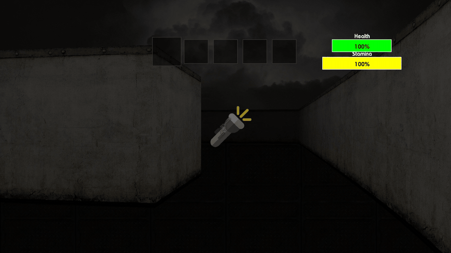
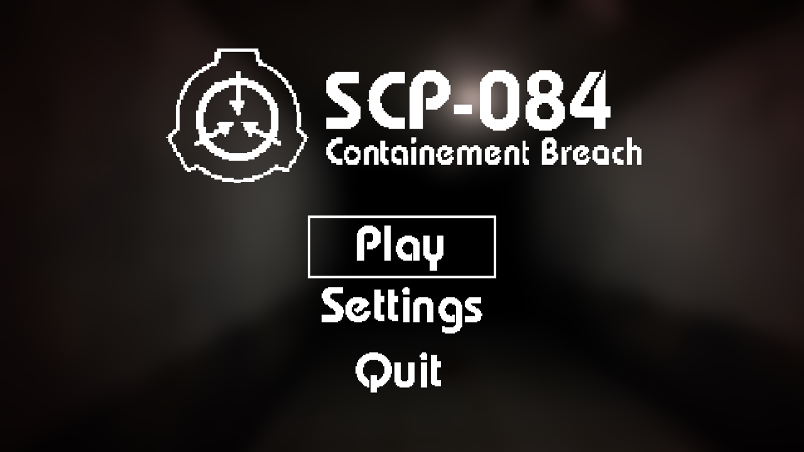
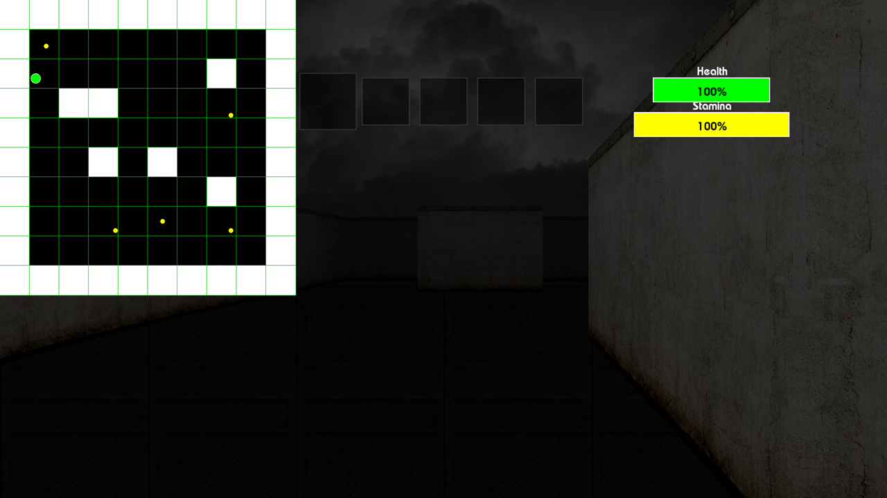
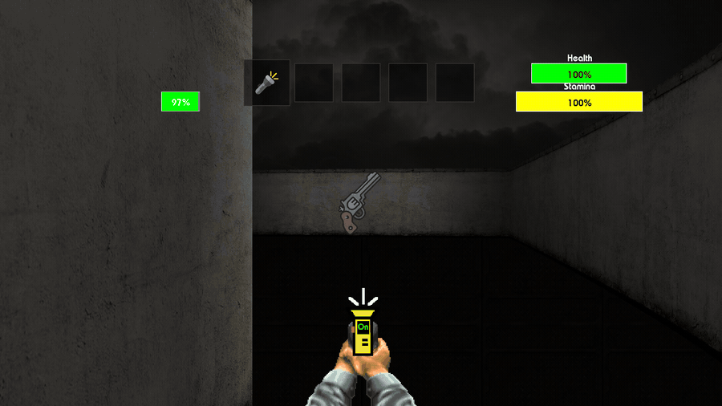

# Wolf3D

A first-person game written in C with CSFML, rendered by raycasting in the style of Wolfenstein 3D: no 3D engine, every column of the view is computed by hand. The player explores a grid map with textured walls, floors and ceilings, picks up items, and can save and reload the world. The in-game theme is SCP-084.



| Main menu | Minimap |
|---|---|
|  |  |

**C · CSFML · raycasting · Valgrind**

Epitech project, built in a pair.

## Features

- Raycasting renderer with horizontal and vertical ray casts, textured walls, and textured floor and ceiling.
- Player movement with wall collisions, mouse look, and running with a stamina bar.
- Items placed in the world that can be picked up, dropped and used from an inventory (mouse wheel or number keys 1-5 to change slot):
  - flashlight that can be toggled and drains a battery,
  - gun with a shooting animation and ammunition,
  - key.
- Items are objects of the world: a dropped item stays where it fell and keeps its own state (battery level, ammunition).
- Minimap of the level, items and player, toggled with `M`.
- Save and load from the pause menu: the map (walls, floors, ceilings) goes to `save.txt` and the world items to `item_save.txt`.
- Main menu, settings menu (music and sound effects on/off, window mode) and pause menu, with music and sound effects.



For these recordings, `item_save.txt` places the flashlight and the gun along the first corridor.

## Build & run

Requires `gcc`, `make` and CSFML (graphics, window, system, audio).

```sh
make            # builds ./wolf3d
make re         # full rebuild
make fclean     # remove objects and the binary
```

Run it from the repository root, since assets and save files are loaded with relative paths:

```sh
./wolf3d
./wolf3d -h     # keybinds
```

Controls: `Z`/`S` forward/backward, `Q`/`D` strafe, `A`/`E` or the mouse to look around, `Left Shift` to run, left click to use the selected item, `X` to interact with items, `G` to drop the selected item, `F` to toggle the flashlight, `M` to toggle the minimap, `Escape` to pause.

## Project layout

- `main.c` - entry point, help text and main loop.
- `raycasting/` - ray casting and wall drawing.
- `game/` - game loop, player, collisions, minimap, floor and ceiling, items, inventory, effects, pause menu, save and load.
- `menu/`, `settings/` - main menu and settings screens.
- `events/` - keyboard, mouse and window event handling.
- `structs/` - creation and freeing of the game structures, map and item file loading.
- `shapes/`, `sprites/`, `utility/` - drawing helpers and small utilities.
- `include/` - the `wolf3d.h` header.
- `assets/` - textures, fonts, music and sound effects.
- `save.txt`, `item_save.txt` - the map and items loaded at start and written when saving.

## Team and contributions

Kevin Huynh ([@Nivek-Hyn](https://github.com/Nivek-Hyn)) and Hugo Sorgues.

- Kevin Huynh: textures, floor and ceiling, items and inventory, the flashlight, the gun, save and load, the minimap, and Valgrind fixes.
